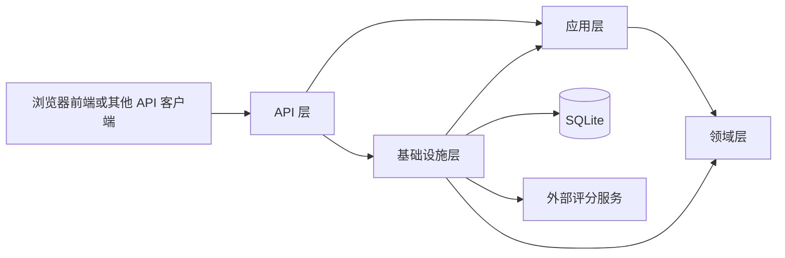

# 后端设计

本页说明首版后端的结构。业务边界见[需求说明](../02-requirements.md)，客户端约定见 [API 手册](../04-api.md)，页面实现见[前端设计](02-frontend.md)。

## 分层

| 项目 | 职责 |
| --- | --- |
| `HomeworkGrading.Api` | 处理 HTTP 路由、输入绑定、身份认证、状态码与错误格式，配置应用依赖。 |
| `HomeworkGrading.Application` | 通过 `AccountService`、`AssignmentService`、`SubmissionService` 编排用例，校验资源归属，定义数据访问与评分接口。 |
| `HomeworkGrading.Domain` | 通过 `Account`、`Assignment`、`Submission` 表达业务对象。作业实体检查截止时间和提交后的改删限制，提交实体检查分数和反馈。 |
| `HomeworkGrading.Infrastructure` | 实现数据访问、数据库迁移、密码哈希与外部评分服务调用。 |

## 数据与一致性

一个教师账号对应多份作业，一份作业对应多份学生提交。每份提交归属于一份作业和一个学生。成绩、评语和批改时间记录在提交中，重新批改时更新该记录。邮箱及「作业 + 学生」组合由唯一索引保护。时间统一转换为 UTC。

提交、改删和批改在写事务内完成。服务层先读当前状态，实体再验证规则，数据库在同一事务内保存。这样提交与删除同时发生时，要么提交先成功并阻止删除，要么删除先成功且提交找不到作业。列表汇总与分页在同一个读取快照上计算。

## 身份与页面请求

登录与注册完成后，API 发出受保护的 Cookie。后续业务请求从 Cookie 读取身份，正常认证路径无需查询账户表。应用层继续检查目标作业或提交的归属。写请求携带固定请求头，浏览器从同一来源调用 API。

列表与详情按页面所需组合数据。教师打开作业详情时先取分页提交摘要，再按需打开某一份完整答卷。学生打开作业详情时直接得到自己的提交和批改结果。

## 模型建议

仅当教师主动请求建议时，基础设施层把题目、标准、参考答案、文字作答与满分交给配置的评分服务。应用层检查建议格式和分数范围。保存正式分数仍通过独立的人工批改操作完成。配置见[开发环境](../06-development/01-setup.md)，选型依据见[技术决策记录](../05-decisions.md)。
